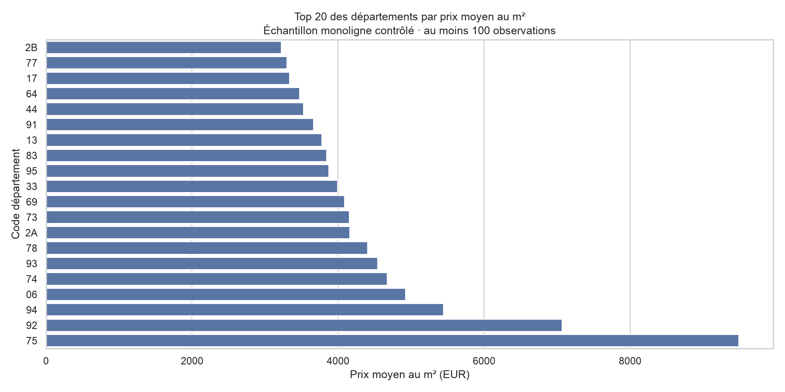
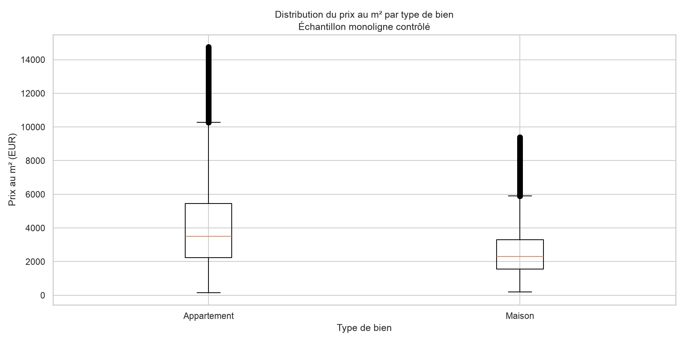
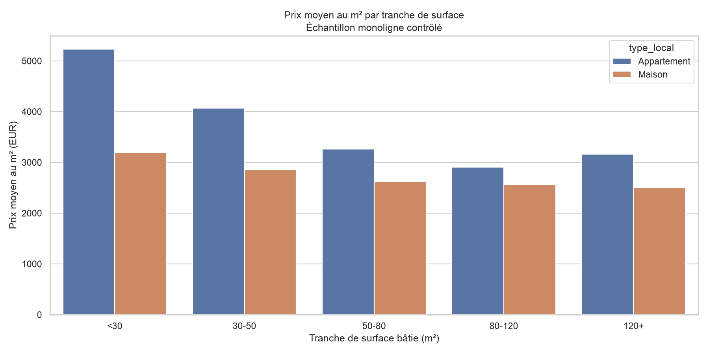
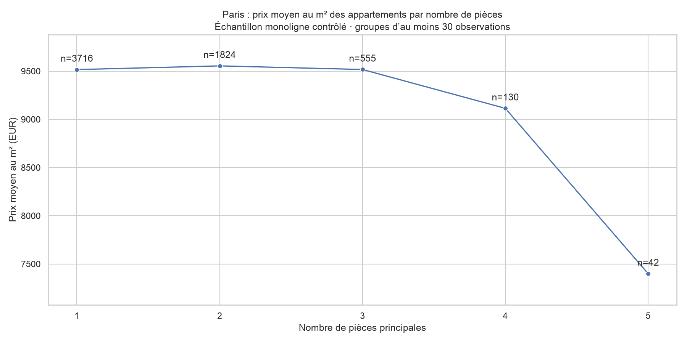

# Analyse DVF 2023

Pipeline ETL Python / Pandas → SQLite → SQL → Matplotlib / Seaborn, appliqué
aux ventes immobilières DVF 2023. Le projet distingue les lignes du fichier,
les opérations immobilières et l'échantillon utilisé pour les prix au m².
Il comprend des contrôles de qualité, une traçabilité des exclusions et une CI.

Sur le CSV local vérifié : **3 812 327 lignes sources**, **857 775 opérations
résidentielles retenues** et **222 341 opérations éligibles aux statistiques
de prix**. Ces trois nombres décrivent des granularités ou des populations différentes.

## Installation et exécution

Python 3.10 ou supérieur, depuis la racine du dépôt :

```bash
python3 -m venv .venv
source .venv/bin/activate
python -m pip install -e ".[dev]"
python main.py --all
```

Les étapes peuvent aussi être exécutées séparément :

```bash
python main.py --download  # réutilise le CSV local s'il est présent et non vide
python main.py --load      # nettoyage, audit, tables/vues SQLite, rapport qualité
python main.py --query     # échantillons des résultats des 10 requêtes SQL
python main.py --viz       # régénération des 5 figures
python -m pytest tests -v
python -m ruff check dvf tests main.py
```

Le premier téléchargement nécessite Internet. Ensuite `--all` fonctionne avec
`data/full.csv`, sans télécharger à nouveau l'archive. Les téléchargements et
la décompression utilisent des fichiers temporaires avant publication. Pour
reproduire les résultats, conserver le même CSV : l'URL `latest` peut évoluer.
Après une mise à jour du code de nettoyage, relancer `--load` avant `--query` ou `--viz`.

Le CSV fait environ 662 Mo. Le traitement Pandas charge le fichier en mémoire ;
prévoir plusieurs Go de RAM et de disque pour les données, l'audit, les tables
intermédiaires et les journaux SQLite. Il ne s'agit pas d'un ETL distribué.

## Architecture et traçabilité

| Fichier | Responsabilité |
|---|---|
| `main.py` | CLI et orchestration des étapes |
| `dvf/download.py` | Téléchargement, cache local, décompression |
| `dvf/clean.py` | Schéma, dates, multiplicités brutes, contrôles et exclusions |
| `dvf/database.py` | Chargement indexé et publication transactionnelle des tables/vues |
| `dvf/queries.py` | 10 analyses SQL : CTE, agrégations, fonctions de fenêtre, médiane |
| `dvf/visualize.py` | 5 graphiques générés sans interface graphique |
| `tests/`, `.github/workflows/ci.yml` | Tests et contrôle Ruff automatisés |

```text
CSV brut conservé
  → normalisation et comptage des lignes AVANT tout filtrage
  → transactions : lignes résidentielles retenues, sans dédoublonnage aveugle
      → operations : une ligne par (id_mutation, numero_disposition), pour les volumes
      → price_transactions : mutations monolignes contrôlées, pour les prix
  → row_audit : une entrée par ligne source, y compris les lignes exclues
  → outputs/quality_report.json et 5 figures PNG
```

La table `transactions` conserve son nom historique mais contient des **lignes**,
pas nécessairement des transactions distinctes. Une opération désigne ici le
couple `(id_mutation, numero_disposition)` ; plusieurs dispositions peuvent
appartenir au même acte. Les identifiants sont lus comme du texte et les numéros
de disposition sont normalisés sur six chiffres.

Une ligne DVF ne constitue pas un identifiant fiable de bien : les parcelles,
locaux, lots, cultures et dépendances peuvent produire plusieurs lignes. Aucune
somme naïve des valeurs foncières ou des surfaces répétées n'est effectuée.
Les comptages distincts déjà présents pour les mois et départements sont conservés,
avec une vue commune `operations`.

`row_audit` conserve `source_row` (rang de l'enregistrement, à partir de 1 hors
en-tête), la clé d'opération, les multiplicités brutes et les motifs d'exclusion
pour les volumes et les prix. Le CSV original permet de retrouver les valeurs
brutes. Chaque motif est le **premier contrôle échoué**, dans l'ordre du code ;
les effectifs par motif ne sont donc pas un inventaire de toutes les anomalies.
Une chaîne vide indique une inclusion. Exemple d'inspection locale :

```sql
SELECT price_exclusion_reason, COUNT(*) AS source_rows
FROM row_audit
GROUP BY price_exclusion_reason;
```

Le [rapport qualité](outputs/quality_report.json), régénéré par `--load`, contient
l'empreinte SHA-256 du CSV, les versions d'exécution, les effectifs, les motifs,
les seuils de prix, les volumes mensuels et le contrôle d'intégrité SQLite.
Les tables sont préparées avant leur remplacement dans une transaction ; un
échec de publication préserve les précédentes tables et vues.

## Périmètres et méthode

**Volumes.** Une opération est comptée si elle possède au moins une ligne de
vente de maison ou d'appartement avec valeur foncière et surface bâtie positives
et finies. La clé, la date, la nature et le département doivent être renseignés
et cohérents dans toutes ses lignes brutes. Les conflits sont exclus et tracés,
sans affectation arbitraire à un département. Les dates ISO `AAAA-MM-JJ` et
françaises `JJ/MM/AAAA` sont analysées explicitement. Les volumes ne représentent
donc pas toutes les mutations DVF et ne dépendent plus des seuils de prix.

**Prix au m².** La valeur foncière peut être répétée sur plusieurs lignes d'une
même disposition. Sans identification fiable de chaque local ni ventilation du
prix, le projet exclut des prix toutes les mutations ayant plusieurs lignes
sources, y compris une maison accompagnée d'une dépendance. Une disposition
monoligne appartenant à une mutation à plusieurs dispositions est également exclue.

Pour les mutations monolignes, les contrôles supplémentaires imposent :

- une maison ou un appartement, avec code de type cohérent et parcelle renseignée ;
- aucune vente en volume ; zéro ou un lot déclaré, cohérent avec les cinq champs de lots ;
- un nombre de pièces entier strictement positif ; une valeur et une surface finies et positives.

Le ratio candidat est `valeur_fonciere / surface_reelle_bati`. Les valeurs hors
quantiles 1 %–99 %, calculés **séparément par type** sur les candidats, sont
exclues des statistiques. Les bornes sont inclusives ; le ratio candidat et le
motif restent consultables. `price_per_m2` vaut `NULL` hors périmètre éligible.
Aucune valeur totale n'est attribuée à chacun des biens d'une vente multibien.

Toutes les requêtes de prix utilisent `price_transactions`. Leur
`transaction_count` indique la taille de l'échantillon de prix, tandis que
`monthly_volume()` et `dept_transaction_share()` utilisent l'ensemble des
opérations retenues. La moyenne est la moyenne non pondérée des ratios individuels,
pas le rapport des sommes. Les classements départementaux exigent 100 observations.
`yoy_comparison()` fournit ici une série mensuelle : une seule année ne permet
pas de mesurer une évolution annuelle. Les candidats au-dessus du 95e percentile
de leur segment sont exploratoires, pas des erreurs avérées.

## Résultats vérifiés et corrections

Validation locale du 19 novembre 2026, sur le même CSV, empreinte SHA-256 :
`84407c24266819b4d12f88da1dbd3d67cd927d4b3991ecb7f0da501a21234c7e`.

L'ancien `dayfirst=True` interprétait les dates ISO en inversant jour et mois et
rejetait les jours supérieurs à 12. Le tableau suivant compare les mêmes lignes
sources, indépendamment des filtres immobiliers :

| Contrôle sur les 3 812 327 lignes brutes | Avant | Après |
|---|---:|---:|
| Dates reconnues | 1 314 441 | 3 812 327 |
| Dates reconnues mais jour/mois inversés | 1 187 076 | 0 |
| Dates rejetées à tort | 2 497 886 | 0 |

Sur l'ancienne sélection figée de **372 724 lignes**, le comptage correct donne
**300 512 opérations**, dont **43 585** multilignes : les **72 212 lignes**
supplémentaires ne sont pas des ventes supplémentaires. L'ancien mois étiqueté
« juin » contenait 40 023 lignes, soit 31 222 opérations distinctes, mais ses dates
étaient elles-mêmes incorrectes. Ces deux valeurs ne décrivent pas le juin corrigé.

Après correction des dates et séparation des périmètres :

| Résultat actuel | Effectif |
|---|---:|
| Opérations brutes distinctes (toutes natures) | 1 369 406 |
| Lignes résidentielles retenues | 1 089 679 |
| Opérations résidentielles distinctes | 857 775 |
| Opérations encore représentées sur plusieurs lignes | 126 217 |
| Opérations retenues en juin 2023, maximum annuel | **87 110** |
| Opérations retenues en juillet 2023 | 85 645 |
| Dispositions résidentielles réellement monolignes dans le brut, avant contrôles des prix | 238 182 |
| Candidats après contrôles structurels | 226 880 |
| Candidats hors quantiles, exclus uniquement des prix | 4 539 |
| Opérations éligibles aux prix | **222 341** |

Les 83 293 dispositions réellement monolignes identifiées dans l'ancienne
sélection n'étaient pas toutes éligibles : **77 887** satisfont la méthode actuelle ;
3 866 sont exclues pour plusieurs lots ou un nombre de lots inconnu, 1 417 pour
prix extrême, 91 pour nombre de pièces invalide et 32 pour mutation à plusieurs
dispositions. Les 173 634 anciennes opérations devenues monolignes seulement
après filtrage ne sont pas assimilées à des ventes simples.

| Échantillon actuel de prix | Opérations | Moyenne €/m² | Médiane €/m² |
|---|---:|---:|---:|
| Appartements | 58 868 | 4 247,20 | 3 500,00 |
| Maisons | 163 473 | 2 590,23 | 2 314,81 |

La moyenne globale actuelle est **3 028,94 €/m²**. Les anciennes moyennes de
4 331,33 €/m² par ligne et de 3 369,87 €/m² sur les seules opérations monolignes
après nettoyage portent sur d'autres populations. Leur différence avec le
résultat actuel **ne mesure ni directement un biais ni une évolution du marché**.
Paris présente une médiane de 9 764,29 €/m² sur 6 296 observations éligibles.

## Validation et limites

- **76 tests réussis**, Ruff sans erreur : dates ambiguës, dépendances, doublons,
  dispositions multiples, lots, valeurs manquantes/infinies, conflits d'opération,
  quantiles, toutes les requêtes de prix, chargement répété et retour arrière.
- CLI complète testée hors réseau sur des CSV synthétiques, y compris un échantillon
  vide, puis exécutée sur le fichier local : audit, SQL et cinq figures régénérés.
- Contrôles locaux : somme des volumes mensuels = somme des volumes départementaux
  = 857 775 ; correspondance des inclusions de l'audit avec les tables/vues ;
  une entrée d'audit par ligne source ; `PRAGMA integrity_check` = `ok`.
- **19 opérations brutes (266 lignes)** ont plusieurs natures de mutation et sont
  mises à l'écart. Aucun conflit de département ni de date n'a été trouvé sur les
  opérations du fichier local. Les données sources ne sont pas corrigées arbitrairement.

Une mutation monoligne contrôlée reste un **proxy prudent**, pas une garantie
d'homogénéité économique. Les maisons peuvent inclure du terrain : 153 087 des
163 473 maisons éligibles déclarent une surface de terrain positive. Les surfaces
fiscales ne sont pas des surfaces Carrez garanties. Des ventes partielles ou des
valeurs atypiques peuvent subsister ; les quantiles ne les identifient pas toutes.

L'exclusion des dépendances, ventes multibiens, lots multiples et valeurs extrêmes
crée un biais de sélection. Ces prix ne sont ni un indice national représentatif,
ni une estimation individuelle de bien. Les effectifs doivent accompagner les
comparaisons ; le graphique parisien ne montre que les groupes d'au moins 30
observations. Le territoire DVF ne couvre notamment pas l'Alsace-Moselle ni Mayotte.
Les identifiants de mutation ne sont pas stables entre livraisons.

## Visualisations







## Données et publication

Les CSV, archives de données, bases SQLite et leurs journaux, environnements
virtuels et fichiers temporaires sont ignorés par Git. Les données locales
restent disponibles ; seules les figures et le rapport agrégé sont destinés
à être versionnés avec le code et les tests.

Sources méthodologiques :

- [DVF géolocalisées : schéma et identifiant de mutation](https://www.data.gouv.fr/datasets/demandes-de-valeurs-foncieres-geolocalisees).
- [Cerema : valeur foncière, dispositions et limites des surfaces](https://doc-datafoncier.cerema.fr/doc/dv3f/mutation/valeurfonc?v=0).
- [data.gouv.fr : statistiques DVF et limites des mutations multibiens](https://www.data.gouv.fr/datasets/statistiques-dvf).
- [Cadastre : présentation et couverture de DVF](https://cadastre.data.gouv.fr/dvf).
