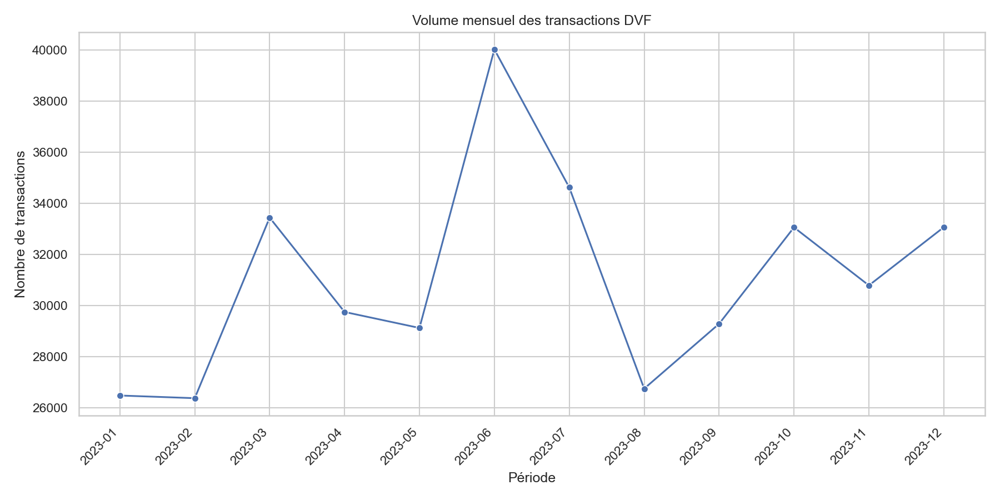

# Analyse DVF 2023

Ce projet propose un pipeline d'analyse de données sur la base DVF
(Demandes de Valeurs Foncières), une source gouvernementale française qui
recense plusieurs millions de transactions immobilières. L'objectif est de
montrer un workflow complet de data engineering et d'analyse: téléchargement du
jeu de données officiel, nettoyage sous Pandas, chargement dans SQLite,
requêtes SQL analytiques, génération de visualisations et validation via tests
automatisés.

## Installation

```bash
python3 -m venv .venv
source .venv/bin/activate
python -m pip install --upgrade pip
python -m pip install -e ".[dev]"
```

## Utilisation

### Télécharger et décompresser la donnée brute

```bash
python main.py --download
```

Produit:
- `data/full.csv.gz`
- `data/full.csv`

### Nettoyer les données et charger SQLite

```bash
python main.py --load
```

Produit:
- `data/dvf.db`

### Exécuter toutes les requêtes analytiques

```bash
python main.py --query
```

Produit:
- affichage dans le terminal d'un échantillon de 5 lignes pour chacune des
  10 requêtes SQL

### Générer toutes les figures

```bash
python main.py --viz
```

Produit:
- `outputs/fig1_avg_price_by_dept.png`
- `outputs/fig2_monthly_volume.png`
- `outputs/fig3_price_distribution.png`
- `outputs/fig4_surface_buckets.png`
- `outputs/fig5_rooms_vs_price.png`

### Exécuter le pipeline complet

```bash
python main.py --all
```

Produit:
- téléchargement, nettoyage, chargement SQLite, exécution des requêtes et
  génération des visualisations

### Vérifier localement avant publication

```bash
python -m pytest tests -v
python -m ruff check dvf tests main.py
```

## Structure du projet

```text
dvf-analysis/
├── .github/workflows/ci.yml
├── data/
├── dvf/
├── outputs/
├── tests/
├── main.py
├── pyproject.toml
└── README.md
```

## Résultats clés

Les observations ci-dessous ont été produites après exécution de
`python main.py --all` sur le fichier DVF 2023 officiel, puis nettoyage du jeu
de données. Le pipeline conserve `372 724` transactions de vente sur des
maisons et appartements avec surface bâtie et valeur foncière exploitables.

- Paris (`75`) domine nettement le classement des départements les plus chers,
  avec un prix médian de `10 311 €/m²`, loin devant les Hauts-de-Seine (`92`,
  `7 042 €/m²`) et le Val-de-Marne (`94`, `5 362 €/m²`).
- Le volume de transactions atteint son maximum en `juin 2023`, avec `40 023`
  ventes, devant `juillet 2023` (`34 619`) et `mars 2023` (`33 438`).
- Les appartements sont structurellement plus chers que les maisons: leur prix
  médian ressort à `3 632 €/m²` contre `2 222 €/m²` pour les maisons, et leur
  prix moyen atteint `5 949 €/m²` contre `2 998 €/m²`.
- Les petites surfaces concentrent les prix les plus élevés: les appartements
  de moins de `30 m²` montent à `8 826 €/m²` en moyenne, tandis que les maisons
  de moins de `30 m²` atteignent `9 725 €/m²`, signe d'un segment atypique et
  très tendu.
- À Paris, le prix au m² des appartements reste très élevé quelle que soit la
  taille du bien: `11 947 €/m²` pour les `1 pièce`, `11 453 €/m²` pour les
  `2 pièces`, `11 133 €/m²` pour les `3 pièces`, puis plus de `13 224 €/m²`
  pour les biens de `6 pièces`.

## Visualisations

### Top 20 des départements par prix moyen au m²


### Volume mensuel des transactions



### Distribution du prix au m² par type de bien


### Prix moyen au m² par tranche de surface


### Paris: prix des appartements par nombre de pièces


## Stack technique

- Python
- Pandas
- SQLite
- SQL brut: window functions, CTEs, agrégations
- Matplotlib
- Seaborn
- GitHub Actions

## Publication GitHub

Le dépôt est prêt à être versionné sur GitHub avec:
- un pipeline reproductible via CLI
- une CI GitHub Actions pour lint + tests
- des visualisations déjà générées pour enrichir la page du dépôt
- un `.gitignore` configuré pour exclure les artefacts locaux
